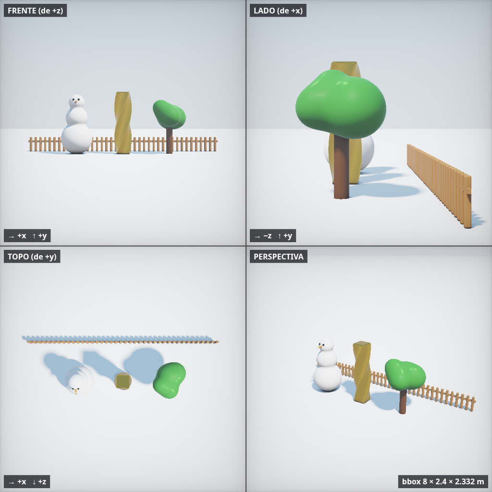

<div align="center">

# 3DI

**Crie cenas 3D com código. Visualize em tempo real. Exporte para GLB.**

Editor desktop e web com linguagem própria, modelagem procedural e integração com agentes via MCP.

[Começar](#começar) · [Exemplos](#exemplos-de-criação) · [Instalação](#instalação-no-linux) · [Build](#build-e-distribuição) · [Documentação](#documentação)

</div>



*Cena [organico.3di](examples/organico.3di): união suave, torção e repetição, renderizadas nas quatro vistas do editor.*

## O que é o 3DI?

O 3DI transforma scripts `.3di` em cenas tridimensionais. A linguagem tem sintaxe semelhante
a Python e oferece primitivas, operações booleanas, deformações, materiais, repetição e animação.
Você combina essas ferramentas em funções reutilizáveis para construir seus próprios modelos.

O preview usa campos de distância assinada (**SDF**) e shaders WebGL2. Na exportação, a engine
converte a cena em malhas **GLB/glTF**, usando tesselação direta para formas compatíveis e
amostragem para operações mais complexas.

| Recurso | O que você pode fazer |
| --- | --- |
| Modelagem por código | Combinar primitivas, extrudar perfis, criar superfícies de revolução e formas implícitas |
| Composição procedural | Usar funções, loops, simetria, repetição e distribuição radial |
| Layout semântico | Apoiar e posicionar peças com `ground`, `place`, `on` e `beside` |
| Materiais | Aplicar cores, metal, rugosidade, emissão, verniz e texturas procedurais |
| Animação | Animar com `time` e `osc`, ou criar esqueletos e vincular peças a ossos |
| Revisão visual | Conferir frente, lado, topo, perspectiva, peças nomeadas e comparação com GLB |
| Exportação | Gerar GLB com materiais, texturas incorporadas, esqueleto e animação compatível |
| Agentes | Consultar documentação, editar cenas, capturar imagens e exportar pelo MCP HTTP |

O app Electron e o editor web compartilham a mesma interface e a mesma engine. O editor Monaco
inclui autocomplete, assinaturas, documentação, snippets e erros na linha. O processamento de
scripts e as exportações usam workers para manter a interface responsiva.

## Começar

### Requisitos

- **Node.js 22.12 ou superior** e npm.
- Ambiente gráfico e suporte a **WebGL2** para o preview.
- Chrome ou Chromium para a ferramenta de renderização por linha de comando.
- Python 3 para o servidor estático usado por essa ferramenta.

O empacotamento disponível no repositório gera um instalador **Linux `.deb`**.

### Executar a partir do código-fonte

Na raiz de uma cópia local deste repositório:

```sh
npm ci
npm run app
```

O comando compila o projeto e abre o aplicativo Electron. Para usar o editor no navegador:

```sh
npm run dev
```

Abra **http://localhost:8327**. O MCP desse ambiente fica em **http://127.0.0.1:8328/mcp**.
As dependências do editor são locais; depois da instalação, a edição não depende de um CDN.

### Criar sua primeira cena

Crie uma cena no editor, cole o código abaixo e salve como `minha-cena.3di`:

```python
chao = plane().color("#e4e8ed")
base = cylinder(0.65, 0.15).ground().color("#334155").name("base")
esfera = sphere(0.35).on(base).color("#38bdf8").material(metal=0.3, rough=0.2)

show(chao, base, esfera)
camera(pos=(2.5, 1.8, 3), look=(0, 0.45, 0))
```

Use as vistas do editor para conferir a composição. Para exportar, escolha GLB ou PNG na interface.

**Convenções da linguagem:** unidades em metros, eixo `y` para cima e `+z` para frente.
Métodos devolvem novas formas: guarde o retorno ao transformar uma peça. Termine a composição
com `show(...)`. A linguagem é um subconjunto de Python, sem imports de módulos Python.

## Exemplos de criação

### Mobiliário com funções reutilizáveis

Uma única perna espelhada monta os quatro apoios. `place` posiciona a peça pelo apoio inferior.

```python
def mesa(w=1.4, d=0.8, h=0.75):
    tampo = box(w, 0.05, d, round=0.01).place(y=h - 0.05)
    perna = cylinder(0.03, h - 0.05).place(w / 2 - 0.08, 0, d / 2 - 0.08)
    return group(tampo, perna.mirror("xz")).color("wood").name("mesa")

m = mesa()
vaso = cylinder(0.08, 0.2).on(m).color("#f97316").name("vaso")
show(plane().color("lightgray"), m, vaso)
```

A [cena completa de mobiliário](examples/mesa.3di) acrescenta cadeiras, uma caneca com alça,
um prato e uma laranja.

### Peças com recortes e materiais

Os operadores `+`, `-` e `&` fazem união, subtração e interseção. Aqui, um cilindro atravessa
uma caixa para formar o furo de uma peça metálica.

```python
corpo = box(0.9, 0.25, 0.7, round=0.03)
furo = cylinder(0.18, 0.6)
peca = (corpo - furo).ground().color("#94a3b8").material(metal=0.8, rough=0.25)
show(plane().color("#e2e8f0"), peca.name("suporte"))
```

Para junções, chanfros, sulcos e pintura com relevo, veja o exemplo [robo.3di](examples/robo.3di)
e o guia de [modelagem hard-surface](docs/rotas/hard-surface.md).

### Animação no preview

`osc` interpola entre dois valores ao longo do tempo. A esfera abaixo sobe e desce enquanto gira.

```python
pedestal = cylinder(0.45, 0.25).ground().color("#475569")
objeto = box(0.4, round=0.06).color("#a78bfa")
objeto = objeto.rotate(y=time * 45).at(0, 0.8, 0).move(y=osc(-0.15, 0.15, 2))
show(plane().color("lightgray"), pedestal, objeto)
```

Transformações com `time` animam o preview. Para exportar animação em GLB, use esqueletos,
ossos e `bind`, como em [boneco.3di](examples/boneco.3di). Animações fora dos ossos são
exportadas em `t=0`.

### Explore as cenas incluídas

Abra o seletor **Exemplos** no editor ou consulte os arquivos:

| Cena | O que demonstra |
| --- | --- |
| [Primitivas](examples/basico.3di) | Formas básicas, cores e operações booleanas |
| [Mesa e cadeiras](examples/mesa.3di) | Funções, medidas, simetria e apoio entre peças |
| [Materiais](examples/materiais.3di) | Texturas procedurais e acabamento |
| [Gato](examples/gato.3di) | Personagem low poly, pintura e facetas |
| [Robô](examples/robo.3di) | Chanfros, junções e relevo |
| [Castelo](examples/castelo.3di) | Arquitetura, recortes e repetição |
| [Vila](examples/vila.3di) | Composição procedural de um cenário |
| [Campo](examples/campo.3di) | Vegetação estilizada com padrões repetidos |
| [Formas](examples/formas.3di) | Extrusão, revolução e deformações |
| [Fórmulas](examples/formulas.3di) | Superfícies implícitas definidas por expressões |
| [Animação](examples/animacao.3di) | Movimento com expressões de tempo |
| [Boneco articulado](examples/boneco.3di) | Esqueleto e exportação animada |

## Validar, renderizar e exportar pela CLI

Os comandos abaixo são executados na raiz do repositório.

```sh
# Executar o script, compilar o shader e conferir peças e dimensões
node scripts/check.mjs examples/mesa.3di

# Mostrar também o GLSL gerado
node scripts/check.mjs examples/mesa.3di --glsl

# Renderizar frente, lado, topo e perspectiva em uma imagem
node scripts/render.mjs examples/mesa.3di /tmp/mesa.png --size 512

# Capturar uma animação em um instante específico
node scripts/render.mjs examples/animacao.3di /tmp/animacao.png --t 1.5

# Exportar GLB; crie a pasta de destino antes
mkdir -p out
node scripts/export.mjs examples/mesa.3di out/mesa.glb --res 128
```

`--size` define o tamanho de cada vista da imagem. `--res` controla o detalhe de exportação
por peça: valores maiores aumentam o custo de processamento e podem aumentar o arquivo.
**A CLI de exportação sobrescreve o arquivo de destino**, portanto escolha um nome adequado.

O preview SDF e a malha exportada usam representações diferentes. Detalhes menores que a célula
de amostragem podem desaparecer em operações complexas. Confira a comparação GLB no editor,
consulte o relatório de qualidade e ajuste a resolução quando necessário. Veja
[o guia de exportação](docs/rotas/exportar.md).

## Instalação no Linux

### Aplicativo empacotado

Gere o instalador a partir do código-fonte:

```sh
npm ci
npm run desktop:deb
```

O pacote é criado em `build/releases/`. Em sistemas Debian ou Ubuntu, instale o arquivo gerado:

```sh
sudo apt install ./build/releases/3di-studio_0.4.0_amd64.deb
```

O nome acima corresponde à versão atual e à arquitetura amd64; use o nome efetivamente gerado
na sua máquina. Depois, abra **3DI** no menu de aplicativos ou execute `3di` no terminal.
O pacote inclui associação para arquivos `.3di`.

### Atalho para desenvolvimento

Para abrir o código-fonte em uma janela Chrome/Chromium pelo menu de aplicativos:

```sh
npm run build
npm run install-desktop

# Opcional: associar arquivos .3di ao modo de desenvolvimento
npm run install-desktop -- --default

# Remover o atalho de desenvolvimento
npm run install-desktop -- --uninstall
```

Esse atalho aparece como **3DI (dev)** e usa as portas de desenvolvimento. Ele depende da
cópia local do repositório; se mover a pasta, reinstale o atalho. O atalho do pacote `.deb`
abre o aplicativo Electron instalado.

## Integração com agentes via MCP

O 3DI disponibiliza um servidor MCP HTTP local. Mantenha o app ou o ambiente web em execução
e use o endereço da instância que deseja controlar:

| Ambiente | Editor | MCP |
| --- | --- | --- |
| Desktop Electron | `http://localhost:8317` | `http://127.0.0.1:8318/mcp` |
| Desenvolvimento web | `http://localhost:8327` | `http://127.0.0.1:8328/mcp` |

O painel **Integrações** mostra a configuração ativa. O MCP usa porta fixa, informa erro se
ela estiver ocupada e encerra junto com o processo. A configuração `.mcp.json` do repositório
aponta para o ambiente de desenvolvimento.

Para conectar ao desktop:

```sh
codex mcp add 3di --url http://127.0.0.1:8318/mcp
claude mcp add --transport http --scope user 3di http://127.0.0.1:8318/mcp
```

Para o editor de desenvolvimento, substitua `8318` por `8328`. O servidor escuta em loopback,
sem autenticação MCP. A ponte interna do editor usa token e valida a origem das requisições.

Um fluxo de criação com agente:

1. Consultar `get_documentation(topic="inicio")` e `describe_language`.
2. Ler a cena com `get_script` antes de editar.
3. Validar o novo código com `check_script` e aplicá-lo com `set_script`.
4. Examinar as quatro vistas com `screenshot(view="grid")`.
5. Conferir a conversão com `check_glb` antes de exportar.
6. Salvar com `save_script` e exportar com `export_glb`.

Documentação e validação de scripts funcionam com o servidor ativo, mesmo sem um editor conectado.
As ferramentas de preview precisam de uma janela do editor. Exportações pelo MCP ficam na pasta
da cena e recusam sobrescrita. Projetos novos incluem instruções para agentes e a skill `3di-scenes`.

No desenvolvimento, é possível configurar as portas ou desligar o MCP:

```sh
THREEDI_PORT=8427 THREEDI_MCP_PORT=8428 npm run dev
THREEDI_MCP=0 npm run dev
```

## Build e distribuição

```sh
npm ci
npm run build
```

Todas as saídas de compilação e empacotamento ficam em `build/`:

| Caminho | Conteúdo |
| --- | --- |
| `build/desktop/` | App Electron, recursos do editor e workers |
| `build/services/` | Serviços compilados usados pelos testes |
| `build/releases/` | Instaladores gerados pelo electron-builder |

`npm run desktop:build` é um alias para `npm run build`. `npm run app` e `npm run dev`
compilam antes de iniciar. Para gerar o instalador Linux, use `npm run desktop:deb`.

Para apagar somente as saídas geradas:

```sh
npm run clean
```

Encerre o app de desenvolvimento antes da limpeza. Cenas e modelos em `out/` são preservados.
Dependências, builds, instaladores e exportações locais não devem ser versionados.

## Testes

```sh
# Verificação de tipos
npm run typecheck

# Build e suíte automatizada
npm test

# Teste de integração no app Electron
npm run desktop:smoke
```

A suíte cobre execução da linguagem, compilação, exportação GLB, materiais, workers, projetos,
workspace e MCP HTTP. Os testes HTTP abrem portas temporárias em loopback.

O smoke test abre uma janela Electron e verifica comunicação com o editor, ferramentas MCP,
operações de arquivos, documentação e captura de imagem. Execute-o em um ambiente gráfico
com suporte a WebGL2. Mudanças de geometria também devem ser conferidas visualmente nas
vistas do editor e na malha exportada.

## Estrutura do repositório

```text
apps/desktop/    Aplicativo Electron e integração com o sistema operacional
src/             Linguagem, geometria, compilador, renderização e exportação
  ide/           Interface compartilhada pelo navegador e pelo desktop
  services/      MCP HTTP, servidor da IDE, projetos, workspace e workers Node
scripts/         Build, desenvolvimento, instalação e utilitários de linha de comando
tests/           Testes automatizados
docs/            Referência da linguagem e guias por tema
examples/        Cenas .3di para estudo e demonstração
assets/          Ícones, imagens e recursos visuais distribuídos
skills/          Skill de modelagem para agentes
build/           Saídas geradas de build e empacotamento
out/             Exportações locais de modelos
```

## Documentação

- [Por onde começar](docs/rotas/inicio.md)
- [Fundamentos e posicionamento](docs/rotas/fundamentos.md)
- [Formas e perfis](docs/rotas/formas.md)
- [Combinações e repetição](docs/rotas/combinar.md)
- [Materiais e pintura](docs/rotas/materiais.md)
- [Animação](docs/rotas/animacao.md)
- [Revisão de modelos](docs/rotas/revisao.md)
- [Exportação GLB](docs/rotas/exportar.md)
- [Ferramentas MCP](docs/rotas/ferramentas.md)
- [Referência completa da linguagem](docs/language.md)

As mesmas rotas estão disponíveis pelo MCP e como recursos `threedi://docs/<rota>`.

## Contribuição

Consulte [CONTRIBUTING.md](CONTRIBUTING.md) para preparar o ambiente e verificar alterações.
Ao modificar a linguagem ou as ferramentas MCP, atualize também a documentação correspondente.

## Licença

O projeto está marcado como **UNLICENSED**. A licença de distribuição ainda precisa ser definida
antes da publicação como open source. Dependências de terceiros mantêm suas próprias licenças.
